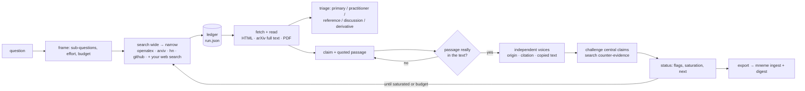

# organon-research

**Research with receipts.** The research organ of [organon](https://github.com/Philipjj609/organon). A model (or you) frames, reads and proposes claims. This tool keeps the ledger, fetches and triages sources, **checks that every quoted passage is really in the source**, counts independent voices instead of pages, makes you challenge central claims, and exports the result to a memory such as [mneme](https://github.com/Philipjj609/mneme) with each claim tied to its passage.



## Why

Research agents produce citations faster than anyone can check them. Published audits find 3–13% of citation URLs fabricated, and only 39–77% of claims accurate against the agents' own cited sources ([Cited but Not Verified](https://arxiv.org/abs/2605.06635)). Existing tools check that a reference exists or a URL resolves ([CiteSentry](https://pypi.org/project/citesentry/)), or judge relevance with a model. None makes a passage-level check the gate through which every claim must pass. That check is cheap and deterministic, so this organ makes it mandatory, and adds the second gap: **independence**. Five pages repeating one article are one voice.

## Use

```bash
cargo install --git https://github.com/Philipjj609/organon-research organon-research
R=organon-research
$R new "Which open-source OCR reads source code in screenshots best?" --effort compare
X=open-source-ocr-reads-source-code
$R search $X all OCR source code screenshots            # keyless: OpenAlex, arXiv, HN, GitHub
$R add $X https://par.nsf.gov/servlets/purl/10220037 --query "<your web search>"
$R fetch $X                                             # next 5 by priority (PDF via pdftotext)
$R claim $X "Tesseract is not the best engine for code" --central
$R cite $X C1 S45 "the default choice in previous work, Tesseract, was never in the top three best performing OCR engines"
$R search $X openalex Tesseract 5 accuracy code --challenges C1
$R status $X                                            # voices, flags, saturation, next steps
$R export $X --about concept:ocr --name "OCR"           # → messages.jsonl + proposal.json
$R eval set.json --out results.json                     # score runs stage by stage (eval/README.md)
```

For agents, the full loop and its rules are in [skills/research/SKILL.md](skills/research/SKILL.md). PDFs need `pdftotext` (poppler) on PATH.

## First real run

The question above: 15 searches, 57 candidates, 13 fetched (8 readable; 4 publisher 403s and 1 script-rendered page recorded as such), 7 claims, 14 citations (13 verified).
- A paraphrased quote was rejected; every verbatim quote was located to the character.
- 2 claims were corroborated by independent voices.
- The VLM-beats-OCR claim came out **contested**: the challenge search found PP-OCRv5's counter-evidence.
- The headline accuracy numbers stayed **single voice**, which the export says.

See [docs/DESIGN.md](docs/DESIGN.md).

## License

MIT OR Apache-2.0.
