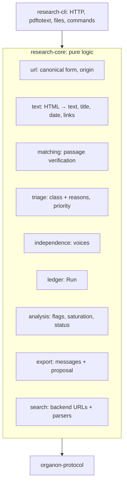

# organon-research design

Design v0.1 follows [organon/docs/organs/research.md](https://github.com/Philipjj609/organon/blob/main/docs/organs/research.md). This file covers what v0.1 implements, how it works, and what it does not do yet.

## Split of work

| The reader (model or person) | The tool |
|---|---|
| frames sub-questions, writes queries | keeps the ledger (`run.json`): queries, sources, claims, citations |
| decides what to read, reads it | fetches, extracts text (HTML, arXiv full text, PDF), dedupes by canonical URL |
| states claims, quotes passages | **verifies each passage** against the stored text and records the verdict |
| judges meaning and conflicts | groups sources into independent voices, flags weak claims, tracks saturation and budget |
| writes the synthesis | exports protocol messages + a proposal for memory |

Producer ≠ verifier, at the cheapest possible level: the model proposes, deterministic code checks.

## Passage verification (`matching`)

- Text and passage become sequences of lowercased letter/digit words, each with its character range. Case, punctuation, curly quotes, dashes, line breaks and markup therefore don't matter.
- **Exact:** the word sequence occurs contiguously.
- **Close:** at least 85% of the passage's words occur *in order* (longest common subsequence) within a window around the best bag-of-words match. This allows an elision or a typo.
- **Partial** (50–85%) and **Missing** are not verified. Under 6 words is **TooShort**, because a fragment can't carry a claim.
- The verified range, in characters of the stored text, becomes a protocol `passage` observation (`Location::Text`). Its value is the source's own words, not the quote.
- Failed citations are kept: the rate at which the reader misquotes is a quality signal.

Tests pin the behaviour. Reordered words fail, a paraphrase fails, an invention that shares words fails, and offsets count characters, not bytes.

## Independence (`independence`)

Sources join one group when any of these holds:
- **Same origin.** One company or author: the site; on GitHub, X, Medium and YouTube, host + author; on tenant hosts like `*.substack.com`, the subdomain; on arXiv, DOI and HN, each document stands alone.
- **One links to the other's canonical URL.**
- **Copied text.** At least 50% of the smaller document's word 5-grams appear in the other. Containment rather than Jaccard, so a short post that lifts part of a long article is caught.

Limit: a paraphrase with no link and no shared wording is not detected. Voice counts are an upper bound on independence.

## Triage (`triage`)

A class with spelled-out reasons, never a truth score:
- **Derivative** is checked first: a listicle title ("Top 10 …", "best … 2026") or 3+ affiliate links.
- **Primary:** paper hosts, code hosts, `.gov/.edu/.ac.*`, `docs.*`.
- **Reference:** Wikipedia.
- **Discussion:** HN, Reddit, X.
- **Practitioner:** blogs and talks.
- **Unknown:** everything else.

Reading priority = class weight + 1 for each extra query that found the source − 0.05 per year of age.

## Flags, saturation, budget (`analysis`)

| flag | meaning |
|---|---|
| unverified | no verified supporting passage (export turns the claim into an open question) |
| single voice | central, and all support comes from one group |
| unchallenged | central, and no counter-evidence search was run |
| contested | a verified passage argues against it (export keeps it as a question citing that passage, because the protocol has no negated stance) |

- **Saturated:** at least the effort's minimum number of sources read, and the last 3 added no claim.
- **Budgets:** lookup 10 searches / 8 sources (min 3); compare 30 / 25 (min 8); deep 80 / 60 (min 15). These follow Anthropic's published effort-scaling rules.

## Backends

All keyless:
- **OpenAlex** (scholarly works).
- **arXiv** (one request per 3 s; full text from `arxiv.org/html/<id>` when it exists).
- **HN Algolia** (practitioner discussion).
- **GitHub** repository search (10 per minute without a token).

General web search stays with the agent's own tool; its results come in through `add --query`, so the search is still recorded. Semantic Scholar is left out: unreliable without a key.

## Not yet

- **Script-rendered pages and publisher walls fail.** The failure is recorded; finding an open copy is the reader's job. A headless browser would be organon-vision/text territory.
- **No model in the loop.** Planning, reading and the entailment judgment ("does this passage *support* the claim, or only contain the words?") stay with the reader. An optional verifier model (cheap model judges entailment, strong model plans) is the next step.
- **Source reliability is static.** It should learn from outcomes: sources whose claims held up gain trust.
- **Evaluation is lexical.** `organon-research eval` ([eval/README.md](../eval/README.md)) scores plan, retrieval, source quality, alignment and synthesis per run by term and URL matching, with spend. Alignment is containment, not entailment, until a verifier model exists.
